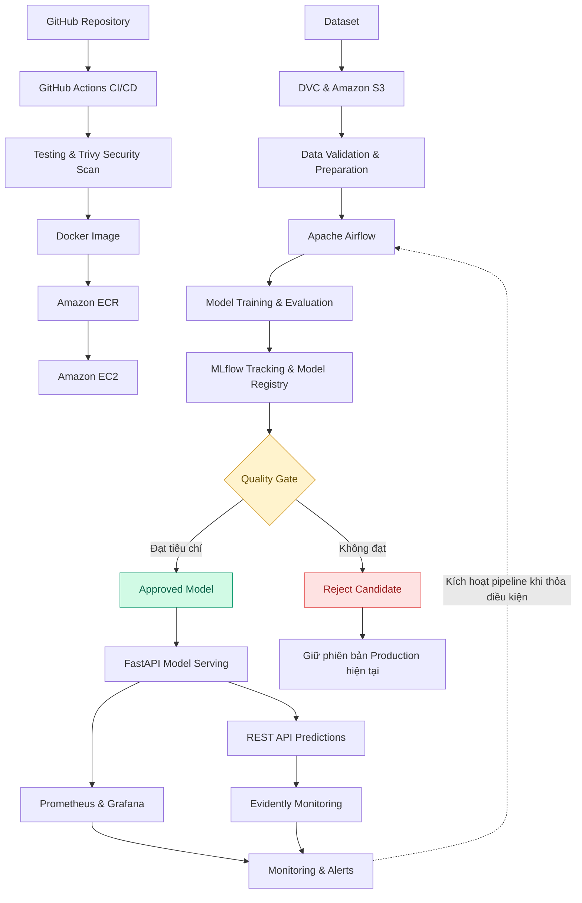

 

# XÂY DỰNG NỀN TẢNG MLOps END-TO-END TRÊN AWS

### Tự động hóa vòng đời Machine Learning từ phát triển, huấn luyện đến triển khai và giám sát mô hình

  
  
  
  

**ĐỒ ÁN NT132 (QUẢN TRỊ MẠNG VÀ HỆ THỐNG) — NHÓM 4**

---

## 📌 1. Giới thiệu đề tài

Trong các hệ thống ứng dụng Machine Learning, việc xây dựng mô hình chỉ là một phần của toàn bộ quy trình. Để mô hình có thể được sử dụng và duy trì trong thực tế, hệ thống cần quản lý dữ liệu, theo dõi các lần huấn luyện, đánh giá chất lượng, triển khai mô hình, giám sát hoạt động và cập nhật mô hình khi cần thiết.

Nếu những công việc này được thực hiện thủ công, quy trình phát triển dễ thiếu tính nhất quán, khó tái lập kết quả và tốn nhiều công sức khi cập nhật hoặc vận hành mô hình.

Đề tài **Xây dựng nền tảng MLOps End-to-End trên AWS** hướng đến việc thiết kế một nền tảng hỗ trợ quản lý và tự động hóa vòng đời Machine Learning, kết hợp các công cụ quản lý phiên bản dữ liệu, điều phối pipeline, theo dõi thí nghiệm, đóng gói ứng dụng, triển khai Cloud và giám sát mô hình.

Nền tảng được định hướng thử nghiệm thông qua bốn bài toán tiêu biểu, qua đó đánh giá khả năng áp dụng quy trình MLOps cho các loại tác vụ Machine Learning khác nhau.

## 🎯 2. Mục tiêu đề tài

Đề tài tập trung vào ba mục tiêu chính:

### 2.1. Tự động hóa vòng đời Machine Learning

Xây dựng quy trình hỗ trợ quản lý dữ liệu, tiền xử lý, huấn luyện, đánh giá, quản lý phiên bản mô hình, triển khai và giám sát. Sử dụng các công cụ phù hợp để giảm thao tác thủ công và nâng cao khả năng tái lập thí nghiệm.

### 2.2. Triển khai nền tảng trên Cloud

Ứng dụng các dịch vụ AWS kết hợp Docker để triển khai và vận hành các thành phần của hệ thống trong môi trường Cloud. Tích hợp quy trình CI/CD nhằm hỗ trợ kiểm thử, đóng gói và phát hành các thành phần phần mềm.

### 2.3. Kiểm chứng trên các bài toán thực tế

Thử nghiệm nền tảng trên bốn bài toán Machine Learning:

- **Fraud Detection:** Phát hiện giao dịch gian lận.
- **Customer Churn Prediction:** Dự đoán khả năng khách hàng rời bỏ dịch vụ.
- **Recommendation System:** Hệ thống gợi ý sản phẩm hoặc nội dung.
- **Demand Forecasting:** Dự báo nhu cầu.

## 💡 3. Lợi ích kỳ vọng

| Lợi ích | Mô tả |
|---|---|
| **Reproducibility & Traceability** | Quản lý phiên bản dữ liệu, mã nguồn, tham số, metrics và model artifacts để hỗ trợ tái lập, so sánh và truy vết các lần huấn luyện. |
| **Operational Efficiency** | Tự động hóa các bước trong quy trình phát triển và triển khai mô hình, giảm công việc lặp lại. |
| **Continuous Model Monitoring** | Theo dõi chỉ số vận hành và sự thay đổi của dữ liệu hoặc dự đoán, hỗ trợ phát hiện vấn đề và kích hoạt quy trình đánh giá, tái huấn luyện khi đáp ứng điều kiện. |

## 🏗️ 4. Kiến trúc hệ thống

Nền tảng được định hướng theo kiến trúc MLOps gồm các thành phần phối hợp để quản lý vòng đời mô hình, từ dữ liệu đầu vào đến dịch vụ dự đoán và hoạt động giám sát.

### 4.1. Sơ đồ luồng hoạt động tổng thể

*Sơ đồ mô tả luồng logic dự kiến. Các kết nối, điều kiện kích hoạt và cơ chế triển khai cụ thể sẽ được hoàn thiện theo cấu hình thực tế của hệ thống.*

### 4.2. Các thành phần chính

| Thành phần | Vai trò |
|---|---|
| **GitHub** | Quản lý mã nguồn, phiên bản code và cấu hình dự án. |
| **GitHub Actions** | Tự động hóa kiểm thử, build và quy trình CI/CD. |
| **Docker** | Đóng gói ứng dụng cùng các dependencies cần thiết. |
| **Trivy** | Hỗ trợ quét các lỗ hổng bảo mật trong container image và các thành phần thuộc phạm vi kiểm tra. |
| **Amazon EC2** | Cung cấp môi trường máy chủ để chạy các dịch vụ của nền tảng. |
| **Amazon S3** | Lưu trữ dataset, model artifacts và các tài nguyên phù hợp với thiết kế. |
| **Amazon ECR** | Lưu trữ và quản lý Docker images. |
| **DVC** | Quản lý phiên bản dữ liệu và hỗ trợ tái lập thí nghiệm. |
| **Apache Airflow** | Điều phối các bước trong pipeline Machine Learning. |
| **MLflow** | Theo dõi thí nghiệm, parameters, metrics, artifacts và quản lý phiên bản mô hình. |
| **FastAPI** | Xây dựng REST API phục vụ dự đoán bằng mô hình đã được phê duyệt. |
| **Prometheus** | Thu thập và lưu trữ các metrics giám sát được cấu hình. |
| **Grafana** | Trực quan hóa metrics thông qua dashboard và hỗ trợ cảnh báo. |
| **Evidently** | Hỗ trợ đánh giá, phân tích data drift và prediction drift. |
| **PostgreSQL** | Hệ quản trị cơ sở dữ liệu quan hệ, dự kiến phục vụ metadata hoặc trạng thái workflow theo cấu hình triển khai. |

## ⚙️ 5. Quy trình hoạt động

Quy trình MLOps của hệ thống được chia thành các giai đoạn chính.

### Bước 1. Quản lý mã nguồn và dữ liệu

- Sử dụng GitHub để quản lý mã nguồn và cấu hình pipeline.
- Sử dụng DVC để quản lý phiên bản dữ liệu.
- Sử dụng Amazon S3 làm nơi lưu trữ dữ liệu và artifacts theo thiết kế.

### Bước 2. Kiểm tra và tiền xử lý dữ liệu

Dữ liệu đầu vào được kiểm tra schema, kiểu dữ liệu, giá trị thiếu và các điều kiện hợp lệ trước khi thực hiện tiền xử lý và trích xuất đặc trưng.

### Bước 3. Huấn luyện và đánh giá mô hình

Apache Airflow điều phối các tác vụ trong pipeline, bao gồm tiền xử lý, huấn luyện và đánh giá. MLflow ghi nhận thông tin của từng lần chạy nhằm hỗ trợ so sánh và truy vết kết quả.

### Bước 4. Kiểm soát chất lượng và quản lý phiên bản

Mô hình ứng viên được đánh giá theo các tiêu chí phù hợp với từng bài toán. Quality Gate quyết định mô hình có đủ điều kiện để được phê duyệt hay không.

Nếu không đạt tiêu chí, mô hình ứng viên bị từ chối và phiên bản Production hiện tại tiếp tục được sử dụng.

### Bước 5. Đóng gói và triển khai

Các thành phần ứng dụng được đóng gói bằng Docker. GitHub Actions hỗ trợ quy trình CI/CD; Docker images được lưu trữ trên Amazon ECR và triển khai lên môi trường Amazon EC2 theo cấu hình hệ thống.

### Bước 6. Phục vụ dự đoán và giám sát

FastAPI cung cấp REST API để ứng dụng bên ngoài gửi dữ liệu đầu vào và nhận kết quả dự đoán. Prometheus, Grafana và Evidently hỗ trợ giám sát các chỉ số vận hành cũng như sự thay đổi của dữ liệu và đầu ra mô hình.

### Bước 7. Tái huấn luyện khi cần thiết

Khi xuất hiện điều kiện kích hoạt phù hợp, hệ thống có thể chạy lại pipeline thông qua Airflow. Mô hình mới vẫn phải được đánh giá và vượt qua Quality Gate trước khi được Promote.

**Lưu ý:** Phát hiện drift không đồng nghĩa với việc mô hình chắc chắn giảm độ chính xác. Việc đánh giá hiệu năng cần sử dụng nhãn hoặc giá trị thực tế khi có thể.

## 🧪 6. Các bài toán thử nghiệm

### 6.1. Fraud Detection — Phát hiện gian lận

**Mục tiêu:** Xây dựng mô hình phân loại nhằm nhận diện các giao dịch có dấu hiệu gian lận.

**Định hướng đánh giá:**
- Precision.
- Recall.
- F1-score.
- ROC-AUC khi phù hợp với dữ liệu và phương pháp đánh giá.

**Vai trò của MLOps:** Quản lý phiên bản dữ liệu, tự động hóa huấn luyện, theo dõi kết quả và quản lý phiên bản mô hình phục vụ dự đoán.

### 6.2. Customer Churn Prediction — Dự đoán khách hàng rời bỏ

**Mục tiêu:** Dự đoán khả năng khách hàng ngừng sử dụng dịch vụ dựa trên các đặc trưng phù hợp.

**Định hướng đánh giá:**
- Precision.
- Recall.
- F1-score.
- ROC-AUC.

**Vai trò của MLOps:** Theo dõi các lần huấn luyện, so sánh metric và kiểm soát việc phê duyệt phiên bản mô hình mới.

### 6.3. Recommendation System — Hệ thống gợi ý

**Mục tiêu:** Xây dựng mô hình hoặc thuật toán đề xuất sản phẩm, nội dung hoặc đối tượng phù hợp dựa trên dữ liệu tương tác.

**Định hướng đánh giá:**
- Precision@K.
- Recall@K.
- NDCG@K khi phù hợp với thiết kế bài toán.

**Vai trò của MLOps:** Chuẩn hóa pipeline, quản lý phiên bản dữ liệu và mô hình, đồng thời hỗ trợ theo dõi sự thay đổi của dữ liệu tương tác.

### 6.4. Demand Forecasting — Dự báo nhu cầu

**Mục tiêu:** Dự đoán nhu cầu trong tương lai dựa trên dữ liệu lịch sử và các đặc trưng phù hợp.

**Định hướng đánh giá:**
- MAE (Mean Absolute Error).
- RMSE (Root Mean Squared Error).

**Vai trò của MLOps:** Quản lý các lần huấn luyện, theo dõi sai số dự báo và hỗ trợ cập nhật mô hình khi dữ liệu thay đổi.

*Các metric trên là định hướng đánh giá. Kết quả thực nghiệm sẽ được bổ sung sau khi nhóm hoàn thành huấn luyện và kiểm thử trên các bộ dữ liệu đã lựa chọn.*

## 📊 7. Định hướng đánh giá hệ thống

Hiệu quả của nền tảng dự kiến được đánh giá trên hai khía cạnh.

### 7.1. Chất lượng mô hình

- Sử dụng metric phù hợp với từng bài toán.
- So sánh các phiên bản mô hình trên tập dữ liệu đánh giá.
- Kiểm tra cơ chế Quality Gate đối với mô hình ứng viên.

### 7.2. Khả năng vận hành MLOps

- Khả năng thực thi pipeline huấn luyện và đánh giá.
- Khả năng quản lý, truy vết phiên bản dữ liệu và mô hình.
- Khả năng triển khai và gọi REST API.
- Khả năng thu thập, hiển thị các metrics giám sát.
- Khả năng kích hoạt pipeline và xử lý mô hình không đạt tiêu chí.

Các kết quả định lượng, hình ảnh minh chứng và số liệu kiểm thử sẽ được cập nhật dựa trên quá trình hiện thực hóa thực tế của nhóm.

## 👥 8. Thành viên thực hiện

Đề tài được thực hiện bởi nhóm gồm ba thành viên.

| STT | Họ và tên | MSSV |
|:---:|---|:---:|
| 1 | Tsằn Chí Khoan | `24520852` |
| 2 | Nguyễn Đình Anh Khôi | `24520862` |
| 3 | Trần Minh Khôi | `24520871` |

## 🚀 9. Định hướng phát triển

Sau khi hoàn thiện phiên bản nền tảng ban đầu, hệ thống có thể tiếp tục được phát triển theo các hướng:

- Hoàn thiện pipeline CI/CD và quy trình triển khai tự động.
- Chuẩn hóa tiêu chí Quality Gate cho từng bài toán.
- Nâng cao khả năng theo dõi, truy vết và tái lập thí nghiệm.
- Bổ sung cơ chế cảnh báo và kích hoạt retraining theo điều kiện.
- Kiểm thử hiệu năng API và mức sử dụng tài nguyên.
- Tăng cường bảo mật, quản lý quyền truy cập và bảo vệ thông tin xác thực.
- Đánh giá khả năng mở rộng và tối ưu chi phí triển khai trên AWS.

## 📚 10. Tài liệu tham khảo

- [AWS Documentation](https://docs.aws.amazon.com/)
- [Docker Documentation](https://docs.docker.com/)
- [Apache Airflow Documentation](https://airflow.apache.org/docs/)
- [MLflow Documentation](https://mlflow.org/docs/latest/)
- [DVC Documentation](https://dvc.org/doc)
- [FastAPI Documentation](https://fastapi.tiangolo.com/)
- [Prometheus Documentation](https://prometheus.io/docs/)
- [Grafana Documentation](https://grafana.com/docs/)
- [Evidently Documentation](https://docs.evidentlyai.com/)
- [Trivy Documentation](https://trivy.dev/latest/docs/)

---

**TRƯỜNG ĐẠI HỌC CÔNG NGHỆ THÔNG TIN — ĐHQG-HCM**

*End-to-End MLOps · Machine Learning · Cloud Computing · Automation*

